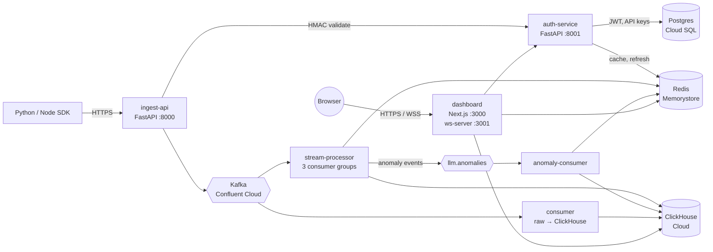

# OpenTelLM

Open-source, self-hostable observability for LLM-powered applications.
Drop-in SDKs auto-instrument your OpenAI / Anthropic / Gemini calls; a
multi-tenant pipeline streams them through Kafka into ClickHouse with
real-time aggregation, anomaly detection, and a Next.js dashboard.

## Architecture



Seven services, four managed dependencies, one event bus.

## Tech stack

| Layer            | Tech                       | Why this, not the alternative |
|------------------|----------------------------|-------------------------------|
| SDKs             | Python + Node.js           | Two languages cover ~95% of LLM apps. Python dominates AI/ML; Node dominates web backends. |
| Ingest API       | FastAPI                    | Async, sub-ms overhead, auto-OpenAPI. Flask is sync; uvloop+FastAPI is the modern default. |
| Event bus        | Kafka (Confluent Cloud)    | Replay capability for failed consumers. Redis Pub/Sub can't replay; SQS can't fan out to N consumer groups cheaply. |
| Analytics DB     | ClickHouse Cloud           | Column-store, append-optimised, 100× faster than Postgres on time-series aggregates. |
| Relational DB    | Postgres 16 (Cloud SQL)    | Tenants, projects, API keys are relational and need ACID. ClickHouse is the wrong tool here. |
| Cache + pubsub   | Redis 7 (Memorystore)      | Sub-ms key cache, atomic INCR for rate limits, pub/sub for live dashboard. |
| Dashboard        | Next.js 14 App Router      | SSR + CSR + API routes in one codebase. SPA-only would force a separate BFF. |
| Container orch   | GKE Autopilot              | Production-grade with no node management. Standard GKE is cheaper at idle but demands ops attention. |
| IaC              | Terraform                  | Declarative, diff-able, reviewable. ClickOps doesn't survive a teammate. |
| CI/CD            | GitHub Actions + WIF       | Free for public repos. Workload Identity Federation = no JSON keys. |

## SDKs

Drop-in instrumentation. Five lines and your existing OpenAI / Anthropic
calls show up on the dashboard. Both SDKs auto-instrument, support
streaming, scrub PII before hashing, and never block your application
code path.

### Python

```bash
pip install opentelm
```

```python
import opentelm
opentelm.init(api_key="opentelm_live_...")
# ... existing OpenAI / Anthropic calls are now traced
```

[Full Python SDK docs →](sdk/python/README.md)

### Node.js

```bash
npm install opentelm-node
```

```ts
import opentelm from "opentelm-node";
opentelm.init({ apiKey: process.env.OPENTELM_API_KEY! });
// ... existing openai / @anthropic-ai/sdk calls are now traced
```

[Full Node SDK docs →](sdk/nodejs/README.md)

## Local development

Five commands from a fresh clone:

```bash
git clone https://github.com/yourorg/opentelm && cd opentelm
cp .env.example .env                 # edit JWT_SECRET_KEY and COOKIE_SECRET
docker compose up -d --build         # Postgres + Redis + Kafka + ClickHouse + 5 services
python infra/postgres/seed_dev.py    # creates a tenant + project + API key
open http://localhost:3000           # log in as dev@example.com / devpassword
```

Run the test suite:

```bash
pip install -r tests/requirements.txt
pytest tests/test_isolation.py -v
pytest tests/test_stream_processor.py -m "not slow" -v   # ~30s
pytest tests/test_dashboard.py -v
```

## Production deployment

### One-time setup

```bash
# 1. Create the GCP project, then bootstrap the TF state bucket
gsutil mb -l asia-south1 gs://opentelm-tfstate-$PROJECT_ID

# 2. Provision infrastructure
cd infra/terraform
cp terraform.tfvars.example terraform.tfvars  # fill in project_id, github_repo
terraform init -backend-config="bucket=opentelm-tfstate-$PROJECT_ID" -backend-config="prefix=infra"
terraform apply

# 3. Configure GitHub Secrets (see "Required GitHub Secrets" below) using the
#    values from `terraform output`.

# 4. Apply the K8s manifests (namespace + configmap + secrets first)
gcloud container clusters get-credentials opentelm-prod --region asia-south1
kubectl apply -f infra/k8s/namespace.yaml

# Materialise opentelm-secrets — see infra/k8s/secrets.yaml.example
cp infra/k8s/secrets.yaml.example infra/k8s/secrets.yaml
# fill in values from `terraform output` and your Confluent / ClickHouse Cloud consoles
kubectl apply -f infra/k8s/secrets.yaml
rm infra/k8s/secrets.yaml      # never commit

kubectl apply -f infra/k8s/configmap.yaml
kubectl apply -R -f infra/k8s/
```

### Subsequent deploys

Push to `main`. The `deploy.yml` workflow:
1. Waits for `ci.yml` to pass on the same SHA.
2. Builds and pushes 5 Docker images to Artifact Registry, tagged with the short SHA.
3. `kubectl set image` for each Deployment + `kubectl rollout status --timeout=300s`.
4. On any failure: `kubectl rollout undo` for every deployment.

### Required GitHub Secrets

| Secret                            | Where it comes from |
|-----------------------------------|---------------------|
| `GCP_PROJECT_ID`                  | Your GCP project |
| `GCP_WORKLOAD_IDENTITY_PROVIDER`  | `terraform output workload_identity_provider` |
| `GCP_SERVICE_ACCOUNT`             | `terraform output deployer_service_account` |
| `JWT_SECRET_KEY`                  | `openssl rand -hex 32` |
| `COOKIE_SECRET`                   | `openssl rand -hex 16` |
| `API_KEY_PEPPER`                  | `openssl rand -hex 16` |
| `CLICKHOUSE_URL`                  | ClickHouse Cloud console |
| `CLICKHOUSE_PASSWORD`             | ClickHouse Cloud console |
| `CONFLUENT_BOOTSTRAP_SERVERS`     | Confluent Cloud cluster page |
| `CONFLUENT_API_KEY`               | Confluent Cloud → API Keys |
| `CONFLUENT_API_SECRET`            | Confluent Cloud → API Keys |

## Engineering decisions

The non-obvious calls. Every one of these is an interview talking point.

- **ClickHouse over Postgres for analytics.** A 24-hour cost-per-tenant query
  against `llm_metrics_1m` returns in single-digit milliseconds at hundreds
  of millions of rows. The same query on Postgres needs custom indexes,
  table partitioning, and still loses by 100×. The price is no `JOIN`s on
  raw events — we precompute aggregates in the stream-processor instead.

- **Kafka over Redis Pub/Sub.** Replay matters. If the metrics-aggregator
  crashes mid-window, it restarts and re-reads from its committed offset;
  no events are lost. Pub/Sub is fire-and-forget — if the subscriber is
  down, the message is gone.

- **Hash prompts and responses, never store raw text by default.** SHA-256
  hashes let us group identical prompts (for prompt regression detection)
  without storing PII. Tenants who explicitly opt in get a separate blob
  store path; the default is privacy-preserving.

- **Auth as a separate service, not a module of ingest-api.** Blast radius:
  an auth bug shouldn't disable telemetry, and a telemetry bug shouldn't
  let unauthenticated users in. Each owns its own Postgres pool and Redis
  client.

- **HMAC pepper for API keys, not just hashing.** A salt would protect
  against rainbow tables, but a pepper (server-side secret) means even a
  full Postgres dump doesn't yield usable keys without also exfiltrating
  the pepper from a different system.

- **WebSocket on a separate Node process, not a Next.js route handler.**
  App Router cannot cleanly upgrade HTTP → WS in route.ts. The Next config
  rewrites `/api/ws/*` to `:3001`, which runs `ws-server.mjs`. Browsers
  see one origin; Kubernetes sees two ports on the same pod.

- **Cost spikes compare an hour with other hours.** An alert fires when a
  project's spend so far this hour is more than 3x its usual hour. "Usual"
  means the average of the hours that had traffic among the previous 24, not
  a plain 24-hour average. A project busy only during office hours would
  otherwise have a baseline of about a third of a normal hour, and every
  working hour would look like a spike. Two floors stop noise: at least
  3 hours of history (so new projects don't alert), and at least $1 spent
  this hour. Hourly totals live in Redis (`hourcost:{tenant}:{project}:{hour}`,
  26h TTL), so restarts and extra replicas need no warm-up. The first
  version compared a whole hour's spend with the cost of a single call and
  fired every hour for every active project. Unit tests now cover the "must
  stay quiet" cases, not only the "must fire" ones.

- **T-Digest for percentiles, not a sorted list.** Storing every latency
  value in memory grows unbounded with traffic. T-Digest is O(1) memory
  per (tenant, project, model, window) with bounded percentile error.

- **Cursor pagination, not offset.** Tuple compare on `(timestamp, trace_id)`
  is O(1) at any depth. Offset pagination skews under concurrent inserts
  and gets slower the deeper you page.

- **GKE Autopilot, not Standard.** Auto-scaling, auto-patching, and
  pod-security defaults that pass a CIS audit. Standard is cheaper at idle
  but the operational burden isn't worth it for a project of this size.

## Roadmap

What's planned next, ordered by what users will feel first:

- **OpenTelemetry export (OTLP).** Emit OpenTelLM events as OTLP spans so
  tenants can pipe them into Honeycomb / Tempo / Datadog without
  duplicating instrumentation.
- **Go SDK.** Same zero-config philosophy, third runtime. Probably via
  `httptrace` rather than monkey-patching since Go discourages that.
- **Prompt playground UI.** Run the same prompt across GPT-4o / Claude
  3.5 / Gemini 1.5 in the dashboard, side-by-side cost + latency +
  output diff.
- **Team / org multi-user support.** Tenants today are single-user.
  Add roles (`owner`, `admin`, `member`), invitations, and a real
  org→user→project hierarchy.
- **Slack and PagerDuty alert destinations.** Anomaly events already
  flow through Kafka — wire a fan-out service to deliver them.
- **Cost budget alerts with hard stop.** Set `budget_usd_per_day` per
  project; when crossed, ingest-api returns 429 until next UTC day.
- **OpenTelemetry instrumentation INSIDE the platform.** Yes, it's
  ironic that the observability platform isn't yet observable. Phase
  6+1.
- **External Secrets operator.** Sync GCP Secret Manager → K8s Secret
  automatically rather than the manual `kubectl apply` step today.
- **Schema migrations.** `infra/postgres/schema.sql` is idempotent for
  the current shape; production needs Alembic or sqitch.
- **SAML / OIDC SSO** for enterprise tenants.

If one of these matters to you, [open an issue](https://github.com/yourorg/opentelm/issues/new/choose)
or send a PR — see [CONTRIBUTING.md](CONTRIBUTING.md).

## License

MIT.
